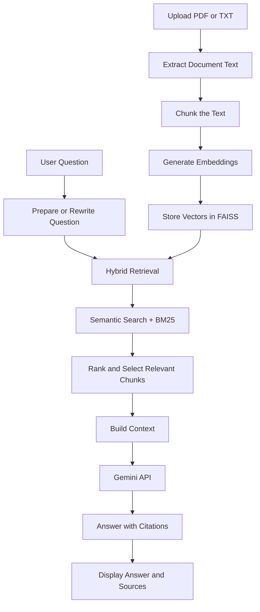

# 📄 Document Q&A Assistant — RAG-Based AI Application

An AI-powered document question-answering application that allows users to upload PDF and TXT files and ask questions about their content. Built using **Retrieval-Augmented Generation (RAG)**, semantic search, hybrid retrieval, and Google's Gemini API to generate context-grounded answers with citations.

🌐 **Live Demo:** [Try the Document Q&A Assistant](https://document-app-assistant-ckyp4pqjzc5pa9q4smvakk.streamlit.app/)

💻 **GitHub Repository:** [document-qa-assistant](https://github.com/rajaji98/document-qa-assistant)

---

## 📌 Table of Contents

- [Overview](#-overview)
- [Key Features](#-key-features)
- [How It Works](#-how-it-works)
- [System Architecture](#-system-architecture)
- [Technology Stack](#-technology-stack)
- [Installation and Setup](#-installation-and-setup)
- [Environment Variables](#-environment-variables)
- [How to Use](#-how-to-use)
- [Retrieval Evaluation](#-retrieval-evaluation)
- [Project Structure](#-project-structure)
- [Deployment](#-deployment)
- [Limitations](#-limitations)
- [Future Improvements](#-future-improvements)
- [Learning Outcomes](#-learning-outcomes)
- [Author](#-author)

---

## 🚀 Overview

Finding specific information in long documents can be time-consuming. Traditional keyword searches may fail to retrieve relevant information when a user's question uses different wording from the original document.

The Document Q&A Assistant addresses this problem using a **Retrieval-Augmented Generation (RAG)** pipeline.

Users upload PDF or TXT documents, ask natural-language questions, and receive answers generated from retrieved document content. The application combines semantic retrieval using Sentence Transformers and FAISS with BM25 keyword retrieval. The retrieved context is then used by the Gemini API to generate answers with citations and source previews.

The application also includes a retrieval evaluation dashboard to inspect document chunks and assess retrieval performance using metrics such as Hit Rate, Mean Reciprocal Rank (MRR), and Precision@K.

### 🎯 Project Objectives

- Build an end-to-end RAG application.
- Retrieve relevant document passages using semantic and keyword-based search.
- Generate context-grounded answers using a large language model.
- Provide source citations to help users verify answers.
- Evaluate retrieval quality using standard information retrieval metrics.
- Deploy the application so users can access it through a web browser.

---

## ✨ Key Features

### 📂 1. Document Upload and Processing
- Upload PDF and TXT documents.
- Extract text from PDF files using PyMuPDF.
- Split extracted text into manageable chunks for retrieval.
- Preserve source information to help identify relevant document passages.

### 🔎 2. Semantic Search
- Generate text embeddings using Sentence Transformers.
- Use the `all-MiniLM-L6-v2` embedding model to represent text semantically.
- Store and search document embeddings using FAISS.
- Retrieve passages based on semantic similarity rather than exact keyword matches alone.

### 🔀 3. Hybrid Retrieval
- Combine semantic search with BM25 keyword retrieval.
- Use configurable retrieval weights to balance semantic relevance and keyword matching.
- Adjust the number of retrieved chunks using the Top K setting.
- Apply a semantic similarity threshold to filter less relevant results.

### 🤖 4. AI-Powered Question Answering
- Integrate Google's Gemini API for answer generation.
- Use retrieved document content as context for responses.
- Provide citations and source previews to support answer verification.
- Help users explore information from their own documents through natural-language questions.

### 💬 5. Conversational Question Answering
- Maintain chat history during a conversation.
- Support follow-up questions.
- Use question rewriting to help resolve follow-ups that depend on earlier context.

### 🧪 6. Retrieval Evaluation Dashboard
- Inspect retrieved document chunks.
- Review retrieval evaluation results.
- Evaluate retrieval using Hit Rate, Mean Reciprocal Rank (MRR), and Precision@K.
- Examine retrieval behavior to identify opportunities for improvement.

### ☁️ 7. Web Deployment
- Built with Streamlit for an interactive web interface.
- Deployed on Streamlit Community Cloud.
- Uses environment secrets for API credentials.

---

## ⚙️ How It Works

The application follows a retrieval-augmented generation workflow.

1. **Upload:** The user uploads a PDF or TXT document.
2. **Text extraction:** Text is extracted from the uploaded file.
3. **Chunking:** The text is divided into smaller passages.
4. **Embedding generation:** Sentence Transformers converts the chunks into vector embeddings.
5. **Indexing:** FAISS stores the embeddings for efficient similarity search.
6. **Question processing:** The user's question is prepared for retrieval, with follow-up rewriting when needed.
7. **Hybrid retrieval:** Semantic search and BM25 retrieve relevant document passages.
8. **Context construction:** Relevant passages are assembled as context for the language model.
9. **Answer generation:** Gemini generates a response using the retrieved context.
10. **Source presentation:** The application displays the answer alongside citations and source previews.

### 🔄 RAG Workflow



---

## 🏗️ System Architecture

The project consists of five major components.

| Component | Responsibility |
|---|---|
| Streamlit interface | Handles document uploads, questions, chat history, settings, and evaluation views |
| Document processor | Extracts text and prepares document chunks |
| Retrieval engine | Performs semantic retrieval with FAISS and keyword retrieval with BM25 |
| Generation component | Sends retrieved context to Gemini to generate an answer |
| Evaluation dashboard | Reports retrieval metrics and supports chunk inspection |

### Why Use RAG?

A language model may not know the contents of a user's private or newly uploaded documents. RAG helps address this by retrieving relevant document passages and supplying them as context at question-answering time.

This approach can improve answer relevance and traceability, although it does not guarantee that every answer is correct.

---

## 🛠️ Technology Stack

| Technology | Purpose |
|---|---|
| Python | Core application logic |
| Streamlit | Interactive web application |
| PyMuPDF | PDF text extraction |
| Sentence Transformers | Text embeddings |
| `all-MiniLM-L6-v2` | Embedding model |
| FAISS | Vector indexing and similarity search |
| BM25 | Keyword-based information retrieval |
| Google Gemini API | Context-grounded answer generation |
| Git and GitHub | Version control and source code hosting |
| Streamlit Community Cloud | Application deployment |

---

## 💻 Installation and Setup

Follow these steps to run the project locally.

### Prerequisites

Install the following before getting started:

- Python 3.10 or another Python version compatible with the project's dependencies.
- Git.
- A Google Gemini API key.
- A compatible version of the dependencies listed in `requirements.txt`.

### 1. Clone the Repository

```bash
git clone https://github.com/rajaji98/document-qa-assistant.git
```

Navigate to the project directory:

```bash
cd document-qa-assistant
```

### 2. Create a Virtual Environment

```bash
python -m venv .venv
```

Activate the environment.

**Windows — PowerShell:**

```powershell
.\.venv\Scripts\Activate.ps1
```

**Windows — Command Prompt:**

```cmd
.venv\Scripts\activate.bat
```

**macOS / Linux:**

```bash
source .venv/bin/activate
```

### 3. Install Dependencies

Install the packages listed in the repository's dependency file:

```bash
python -m pip install --upgrade pip
pip install -r requirements.txt
```

If your repository names the file `Requirements.txt`, use that exact filename instead:

```bash
pip install -r Requirements.txt
```

### 4. Configure Environment Variables

The application requires a Gemini API key for AI-powered answer generation.

Create a `.env` file in the project root if your local setup uses environment variables:

```env
GEMINI_API_KEY=your_gemini_api_key
GEMINI_MODEL=your_supported_gemini_model
```

Replace the placeholder values with your actual credentials and a model supported by your Gemini API account and application code.

**Important:** Never commit `.env` or expose your API key in source code, screenshots, or public repositories.

### 5. Run the Application

Start Streamlit from the project directory:

```bash
streamlit run app.py
```

Streamlit will display a local URL in the terminal. Open that URL in your browser to use the application.

---

## 🔐 Environment Variables

| Variable | Description |
|---|---|
| `GEMINI_API_KEY` | API key used to authenticate Gemini API requests |
| `GEMINI_MODEL` | Gemini model identifier configured for answer generation |

The application deployment should use Streamlit Community Cloud secrets or another secure configuration mechanism for production credentials.

Example Streamlit secrets configuration:

```toml
GEMINI_API_KEY = "your_gemini_api_key"
GEMINI_MODEL = "your_supported_gemini_model"
```

Add these values under **App settings → Secrets** in Streamlit Community Cloud.

Do not commit the real secrets file or actual credentials to GitHub.

---

## 📖 How to Use

### Step 1: Open the Application

Visit the [live application](https://document-app-assistant-ckyp4pqjzc5pa9q4smvakk.streamlit.app/) or run it locally.

### Step 2: Upload a Document

Upload a supported PDF or TXT file containing the information you want to explore.

### Step 3: Ask a Question

Enter a natural-language question about the uploaded document.

For example:

- What are the main findings in this document?
- Summarize the key points.
- What technical skills are mentioned?
- Explain the methodology described in the document.

These are example prompts; the quality of the answer depends on the information available in the uploaded document.

### Step 4: Review the Answer

Read the generated answer and inspect the associated citations or source previews to verify the information.

### Step 5: Ask Follow-Up Questions

Continue the conversation with follow-up questions to explore other aspects of the document.

### Step 6: Evaluate Retrieval

Open the retrieval evaluation and chunk-inspection view to examine retrieved passages and the available evaluation metrics.

---

##  🧪 Retrieval Evaluation

The Document Q&A Assistant includes a retrieval evaluation dashboard to measure how effectively the system retrieves relevant document chunks for a user's question.

The evaluation focuses on three metrics: **Hit Rate, Mean Reciprocal Rank (MRR), and Precision@K**.

### 1. Hit Rate — Did the system find relevant information?

Hit Rate checks whether at least one relevant document chunk appears in the retrieved results for a query.

**Example:**

Suppose we test the application with 10 questions. For 8 questions, the system retrieves at least one relevant chunk.

**Result: Hit Rate = 80%**

This means the retriever found relevant information for 8 out of 10 test questions.

### 2. Mean Reciprocal Rank (MRR) — How high was the first relevant result?

MRR measures how close to the top the first relevant retrieved chunk appears.

**Example:**

- **Question 1:** The first relevant chunk appears at rank 1.
- **Question 2:** The first relevant chunk appears at rank 2.
- **Question 3:** The first relevant chunk appears at rank 4.

The system receives a better score when relevant information appears near the top of the results. If no relevant chunk is retrieved, that query contributes zero to MRR.

**Why it matters:** A higher MRR means users are more likely to find useful information among the first few retrieved chunks.

### 3. Precision@K — How many of the top results were relevant?

Precision@K measures the proportion of the top K retrieved chunks that are relevant to the question.

**Example:**

Suppose the retriever returns 5 chunks for a question:

- 3 chunks are relevant.
- 2 chunks are not relevant.

**Result: Precision@5 = 60%**

This means 3 out of the 5 retrieved chunks were relevant.

**Why it matters:** It helps evaluate whether the system is retrieving useful context instead of adding unnecessary or unrelated text.

### 📊 What Do These Metrics Tell Us?

| Metric | What it evaluates | A good result indicates |
|---|---|---|
| Hit Rate | Whether relevant content was found | Relevant content is found for more queries |
| MRR | Position of the first relevant result | Relevant content appears closer to the top |
| Precision@K | Relevance of the top K results | A greater proportion of retrieved chunks are relevant |

### Why Retrieval Evaluation Matters

In a RAG application, the quality of the retrieved context influences the quality of the generated answer. If the retriever misses relevant information, the language model may produce an incomplete or unsupported response.

These metrics help analyze the retrieval component and identify opportunities to improve search quality.

**Note:** Retrieval metrics evaluate the retrieved results, not the factual correctness of every generated answer. Results depend on the test questions and the relevance labels used during evaluation.

---

## 📁 Project Structure

The repository's core application is organized around a Streamlit entry point and dependency configuration.

```text
document-qa-assistant/
│
├── app.py
├── requirements.txt
├── .gitignore
└── README.md
```

**Note:** This is a simplified view of the main repository files. Your exact dependency filename may be `Requirements.txt` with a capital `R`; use the filename that exists in your repository. Additional configuration or environment files may be present locally.

---

## ☁️ Deployment

The application is deployed using **Streamlit Community Cloud**.

### Deployment Steps

1. Push the application code to GitHub.
2. Sign in to Streamlit Community Cloud.
3. Create an application using the project repository.
4. Select `app.py` as the application entry point.
5. Configure `GEMINI_API_KEY` and `GEMINI_MODEL` in the application's Secrets settings.
6. Deploy the application and test document uploads, retrieval, answer generation, and citations.

### Live Application

🌐 [Open Document Q&A Assistant](https://document-app-assistant-ckyp4pqjzc5pa9q4smvakk.streamlit.app/)

---

## ⚠️ Limitations

- Retrieval quality depends on document text extraction, chunking, embeddings, and search configuration.
- Scanned PDFs may require OCR if their content is not available as extractable text.
- Generated answers may be incomplete or incorrect even when citations are displayed.
- Retrieval metrics depend on the quality of evaluation queries and relevance labels.
- Gemini API access depends on valid credentials, model availability, quotas, and service availability.
- Large documents may require additional processing time and memory.
- Uploaded documents may contain sensitive information; users should avoid uploading confidential material unless they understand the application's data-handling practices.

---

## 🔮 Future Improvements

Potential improvements include:

- Add OCR support for scanned PDF documents.
- Support additional document formats such as DOCX.
- Add more robust chunking strategies and configurable chunk overlap.
- Improve retrieval with a dedicated reranker.
- Expand evaluation using Recall@K, nDCG@K, and answer-faithfulness checks.
- Add automated evaluation datasets and regression tests.
- Improve error handling, caching, and processing performance.
- Add document management features for multiple files and sessions.
- Improve source navigation so users can jump directly to the relevant page or passage.

These are possible future enhancements, not claims about features already implemented.

---

## 🎓 Learning Outcomes

Building this project provided practical experience with:

- Understanding the RAG architecture.
- Extracting and chunking document text.
- Generating embeddings with Sentence Transformers.
- Building semantic search with FAISS.
- Combining semantic and keyword-based retrieval.
- Integrating an LLM API into a Python application.
- Displaying source citations and document-grounded answers.
- Evaluating retrieval using Hit Rate, MRR, and Precision@K.
- Building and deploying an interactive application with Streamlit.

---

## 👨‍💻 Author

**Arun Singh**

B.Tech in Mechanical Engineering — SGSITS, Indore

- **LinkedIn:** [Arun Singh](https://www.linkedin.com/in/arun-singh-ss/)
- **GitHub:** [rajaji98](https://github.com/rajaji98)
- **Project Repository:** [Document Q&A Assistant](https://github.com/rajaji98/document-qa-assistant)
- **Live Demo:** [Try the Application](https://document-app-assistant-ckyp4pqjzc5pa9q4smvakk.streamlit.app/)

---

## ⭐ Support

If you find this project useful, consider giving the repository a ⭐ on GitHub.

Feedback and suggestions for improving the retrieval pipeline, evaluation methods, and user experience are welcome.

**Built with Python, RAG, semantic search, hybrid retrieval, and Generative AI.**